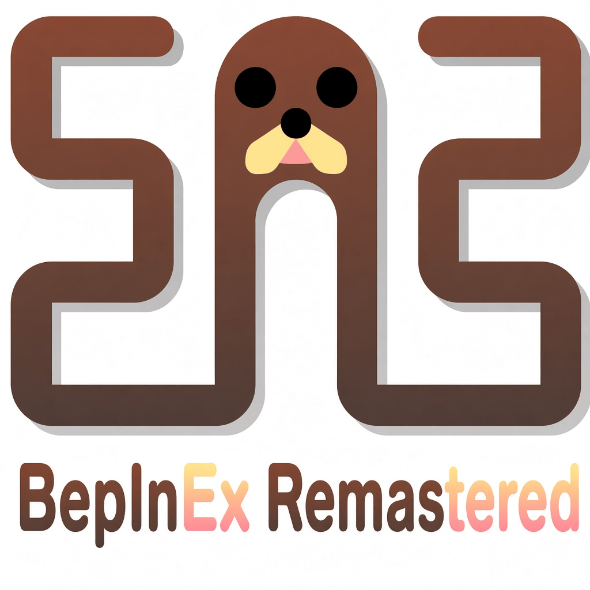

  

  <h1>BepInEx Remastered</h1>

  
<strong>Bepis Injector Extensible — Remastered</strong>

  

    An enhanced modding framework for Unity games, focused on broad compatibility and expanded features.
  

  

    
    
    
    
  

  

    <a href="https://github.com/DreamysHelper/BepInEx-Resmatered/releases/latest"><strong>Download Latest Release</strong></a>
    ·
    <a href="https://discord.gg/dreamymodding"><strong>Discord</strong></a>
    ·
    <a href="https://github.com/DreamysHelper/BepInEx-Resmatered/issues"><strong>Report an Issue</strong></a>
  

---

BepInEx Remastered is an enhanced plugin and modding framework for Unity games. It aims to broaden Unity-version compatibility and provide additional functionality for mod developers.

Support depends on the specific build, game, scripting backend, and platform. Check the release notes for confirmed compatibility.

## Platform compatibility

| Target | Windows | macOS | Linux | ARM |
| --- | --- | --- | --- | --- |
| Unity Mono | Depends on build | Depends on build | Depends on build | Depends on build |
| Unity IL2CPP | Depends on build | Depends on build | Depends on build | Depends on build |
| .NET / XNA / FNA | Depends on runtime | Depends on runtime | Depends on runtime | Depends on runtime |

## Resources

- [**Latest releases**](https://github.com/DreamysHelper/BepInEx-Resmatered/releases)
- [**All releases**](https://github.com/DreamysHelper/BepInEx-Resmatered/releases)
- [**Installation guide**](https://docs.bepinex.dev/articles/user_guide/installation/index.html)
- [**User and developer guides**](https://docs.bepinex.dev/master/)
- [**DreamyModding Discord server**](https://discord.gg/dreamymodding)

## Features

- Broad Unity-version compatibility goals.
- Expanded modding functionality.
- Plugin and chainloader support where implemented.
- Configuration and logging tools.
- Developer-focused workflows.
- Compatibility and stability improvements.

> Feature availability varies by build. Check the release notes before installing.

## Available plugin loaders

| Name | Project |
| --- | --- |
| BSIPA | [BepInEx.BSIPA.Loader](https://github.com/BepInEx/BepInEx.BSIPA.Loader) |
| IPA | [IPALoaderX](https://github.com/BepInEx/IPALoaderX) |
| MelonLoader | [BepInEx.MelonLoader.Loader](https://github.com/BepInEx/BepInEx.MelonLoader.Loader) |
| MonoMod | [BepInEx.MonoMod.Loader](https://github.com/BepInEx/BepInEx.MonoMod.Loader) |
| MuseDashModLoader | [BepInEx.MDML.Loader](https://github.com/BepInEx/BepInEx.MDML.Loader) |
| Partiality | [BepInEx-Partiality-Wrapper](https://github.com/sinai-dev/BepInEx-Partiality-Wrapper) |
| Sybaris | [BepInEx.SybarisLoader.Patcher](https://github.com/BepInEx/BepInEx.SybarisLoader.Patcher) |
| UnityInjector | [BepInEx.UnityInjector.Loader](https://github.com/BepInEx/BepInEx.UnityInjectorLoader) |
| Unity Mod Manager | [Yan.UMMLoader](https://github.com/hacknet-bar/Yan.UMMLoader) |
| uMod | [BepInEx.uMod.Loader](https://github.com/BepInEx/BepInEx.uMod.Loader) |

*Third-party loader compatibility depends on integration and testing in this project.*

## Used libraries

The exact dependencies and versions vary by release. Consult the source and release notes before redistributing third-party components.

- [UnityDoorstop](https://github.com/NeighTools/UnityDoorstop)
- [HarmonyX](https://github.com/BepInEx/HarmonyX)
- [MonoMod](https://github.com/MonoMod/MonoMod)
- [Mono.Cecil](https://github.com/jbevain/cecil)

### IL2CPP libraries

- [Cpp2IL](https://github.com/SamboyCoding/Cpp2IL)
- [Il2CppInterop](https://github.com/BepInEx/Il2CppInterop)
- [BepInEx .NET runtime](https://github.com/BepInEx/DotnetRuntime)

## Contributing

Found a bug or have an idea?

- [Report an issue](https://github.com/DreamysHelper/BepInEx-Resmatered/issues)
- [Browse releases](https://github.com/DreamysHelper/BepInEx-Resmatered/releases)
- [Join the Discord](https://discord.gg/dreamymodding)

When reporting a problem, include the game name, Unity version if known, scripting backend, relevant logs, and steps to reproduce it.

## Credits

- The original [BepInEx project](https://github.com/BepInEx/BepInEx) and its contributors.
- Contributors to third-party dependencies used by the project.
- The DreamyModding community.

BepInEx Remastered is an independent project and is not an official release of the original BepInEx team.

## License

Add the license applicable to this repository in `LICENSE`. Preserve all required licenses and attribution for third-party components.
